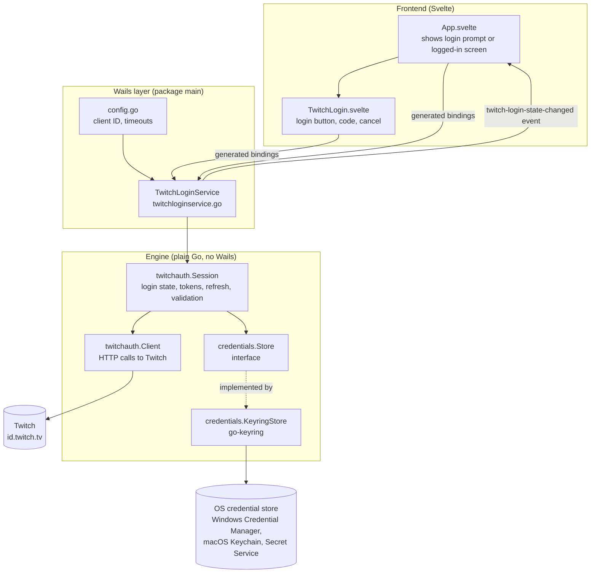
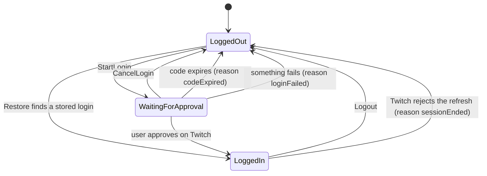
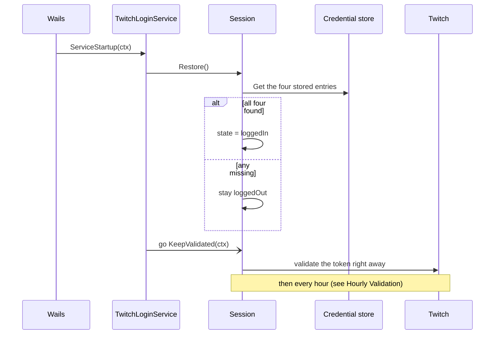
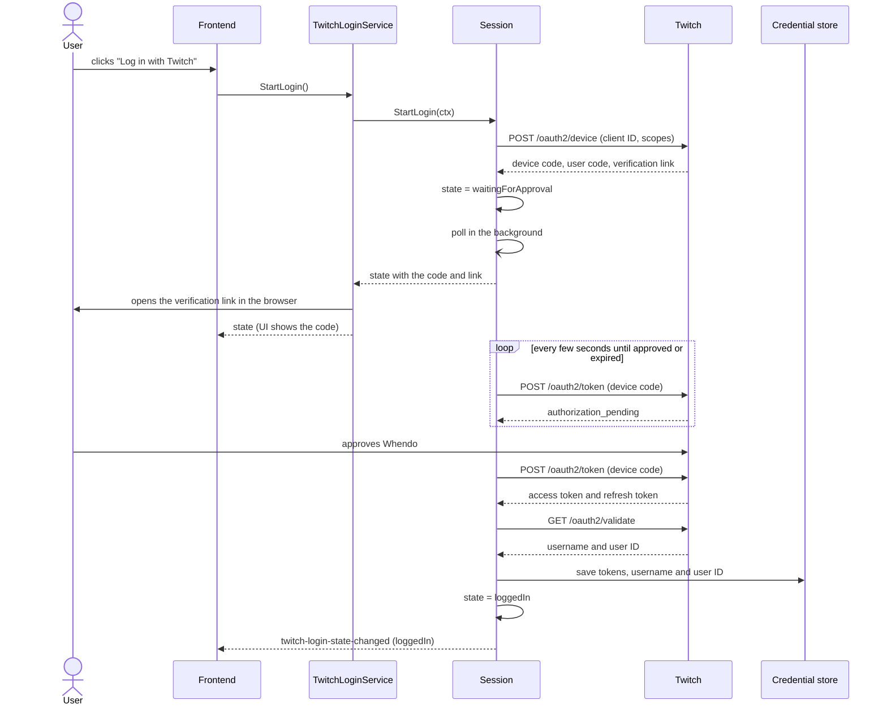
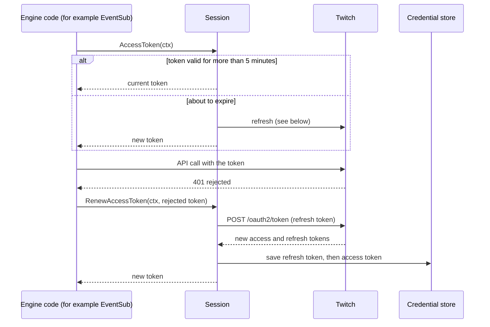
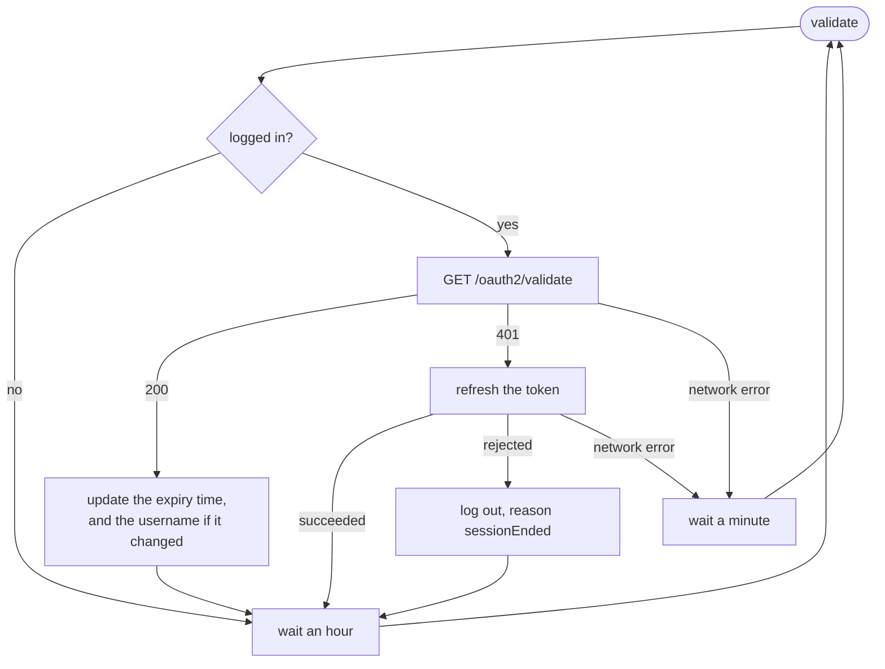
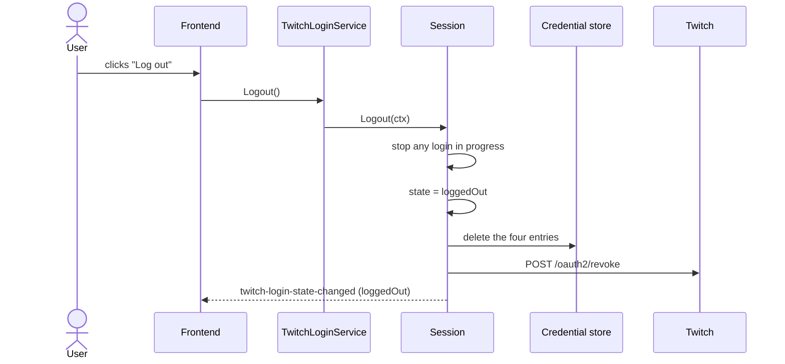

# Twitch Login: How the Code Works

- **Last updated:** 2026-11-15

This page explains how Whendo's Twitch login code fits together: which parts exist, what each public function does, and how they work together for logging in, staying logged in and logging out. It's for developers working on the code. For what the login must do and why, see the design doc, [Twitch Login](../design/twitch-login.md).

## The Pieces



| Piece | File | Job |
|---|---|---|
| `twitchauth.Client` | `engine/twitchauth/client.go` | Makes the HTTP calls to Twitch's OAuth server. Knows nothing about login state. |
| `twitchauth.Session` | `engine/twitchauth/session.go` | Owns the login: its state, the tokens, refreshing, validation and storage. The rest of the engine asks it for tokens. |
| `credentials.Store` | `engine/credentials/credentials.go` | A small interface for saving, loading and deleting secrets, so go-keyring can be replaced without changes elsewhere. |
| `credentials.KeyringStore` | `engine/credentials/credentials.go` | The `Store` backed by the OS credential store, through go-keyring. |
| `TwitchLoginService` | `twitchloginservice.go` | The Wails service the UI calls. Starts the session, opens the browser and forwards state changes. |
| `config.go` | `config.go` | The Twitch client ID, overridable with `WHENDO_TWITCH_CLIENT_ID`, plus the request timeout and the credential service name. |
| `App.svelte`, `TwitchLogin.svelte` | `frontend/src/` | Show the login prompt, the code while waiting, and a placeholder screen once logged in. |

The engine pieces never import Wails. `main.go` wires them together: it creates the `Client`, the `KeyringStore` and the `Session`, and passes the session to `TwitchLoginService`.

## Login States

The session is always in one of three states, reported as a `LoginState`:



`LoginState` carries what the UI needs for each state:

| Status | Fields that are set |
|---|---|
| `loggedOut` | `logoutReason` (empty, `codeExpired`, `sessionEnded` or `loginFailed`) and, for `loginFailed`, `loginErrorMessage` |
| `waitingForApproval` | `userCode` and `verificationUri` |
| `loggedIn` | `accountLogin`, the Twitch username |

Every change is reported through the session's `OnStateChange` callback. `main.go` turns it into the `twitch-login-state-changed` Wails event, which the frontend listens for.

## Session Functions

| Function | What it does |
|---|---|
| `NewSession(config)` | Creates a logged-out session. |
| `State()` | Returns a copy of the current `LoginState`. |
| `Restore()` | Loads a login saved by an earlier run. Doesn't contact Twitch. |
| `StartLogin(ctx)` | Gets a code from Twitch and starts waiting for approval in the background. Refuses if already logged in. |
| `CancelLogin()` | Stops waiting for approval. |
| `Logout(ctx)` | Forgets the login and tells Twitch to revoke the token. |
| `AccessToken(ctx)` | Returns a valid access token, refreshing first if it's about to expire. This is what the rest of the engine calls. |
| `RenewAccessToken(ctx, rejectedToken)` | Gets a new token after Twitch rejected one. Concurrent callers share a single refresh. |
| `AccountUserID()` | Returns the logged-in account's Twitch user ID. |
| `KeepValidated(ctx)` | Checks the login with Twitch immediately and then every hour, until `ctx` is cancelled. |

`TwitchLoginService` exposes a subset to the UI: `GetLoginState`, `StartLogin` (which also opens the browser), `OpenVerificationPage`, `CancelLogin` and `Logout`.

## Startup



The frontend subscribes to `twitch-login-state-changed` first and then calls `GetLoginState`, so it can't miss a change that happens in between.

## Logging In

Whendo uses Twitch's Device Code Grant flow: Twitch gives Whendo a code, the user approves it in their browser, and Whendo polls until the approval arrives.



Details worth knowing:
- **The background polling isn't tied to the call that started it.** Wails cancels a call's context when the call returns, so the polling runs on a context that only `CancelLogin`, `Logout` or a new `StartLogin` cancels.
- **If the code expires,** the state becomes `loggedOut` with reason `codeExpired`, and the UI offers to start again.
- **If saving the login fails,** anything partly saved is removed and the state becomes `loggedOut` with reason `loginFailed`.

## Getting and Refreshing Tokens

Code that calls Twitch's APIs gets its token from the session:



**Only one refresh runs at a time.** Each refresh token works only once, so two refreshes at the same moment would invalidate each other. The session handles this:
1. A refresh holds a dedicated lock, so other refreshes wait.
2. When a waiting caller gets the lock, it compares the token it was given with the current one. If they differ, someone else already refreshed, so it returns the current token without calling Twitch.

So if five callers all report the same rejected token, Twitch sees one refresh and all five get the new token.

**If Twitch rejects the refresh,** the user changed their password, disconnected Whendo, or didn't use it for 30 days. The session logs out with reason `sessionEnded`, removes the stored login and returns `ErrNotLoggedIn`.

**The refresh token is saved first,** because the old one stops working the moment Twitch issues a new one. If saving fails, the new tokens are kept in memory, so the user stays logged in until Whendo closes.

## Hourly Validation

Twitch requires apps to check their token at startup and every hour after. `KeepValidated` does this:



A network error doesn't log the user out. Validation just tries again sooner, so being offline briefly never costs the user their login.

## Logging Out



The login is forgotten locally **before** Twitch is told. If Twitch can't be reached, the user is still logged out; the failure is only logged, and the token expires on its own.

## Discarding Stale Results

Network calls happen without holding the session's lock, so the login can change while one is in progress. For example, the user might log out while a refresh is running.

To handle this, the session keeps a `generation` number that increases on every status change: login, logout, cancel and Twitch ending the session. Before a network call, the code notes the generation. Afterwards, it checks whether the generation is still the same, and throws its result away if it isn't. This stops, for example:
- a refresh that finishes after logout from saving tokens and logging the user back in
- a cancelled login attempt from logging the user in
- an old attempt's "code expired" from replacing a newer attempt's code

A simple status check wouldn't be enough, because the status can return to the same value: a user can log out and back in during a single refresh. The generation number never repeats.

## What's Stored

Each item is its own entry in the OS credential store, under the service name `Whendo`. Windows Credential Manager limits the size of a single entry, so the items aren't bundled into one.

| Entry | Contents |
|---|---|
| `twitch-access-token` | The current access token |
| `twitch-refresh-token` | The current refresh token |
| `twitch-account-login` | The Twitch username, kept so the UI can show it before the first validation |
| `twitch-account-user-id` | The Twitch user ID |

`Restore` only treats the login as present when all four exist.

## Using Your Own Twitch Application

Set `WHENDO_TWITCH_CLIENT_ID` before starting Whendo to log in through your own Twitch application. It must use the **Public** client type. In PowerShell:

```powershell
$env:WHENDO_TWITCH_CLIENT_ID = "<your client ID>"; wails3 dev
```

Logins aren't stored separately for each application, so switching between applications asks you to log in again.

## Tests

`engine/twitchauth/twitchauth_test.go` runs the client and session against a fake Twitch server built with `httptest`, with an in-memory `credentials.Store`. The tests cover logging in, an expired code, cancelling, a single refresh for concurrent callers, logging out when a refresh is rejected, hourly validation refreshing a rejected token, and logout. Run them with:

```sh
go test -race ./engine/...
```
